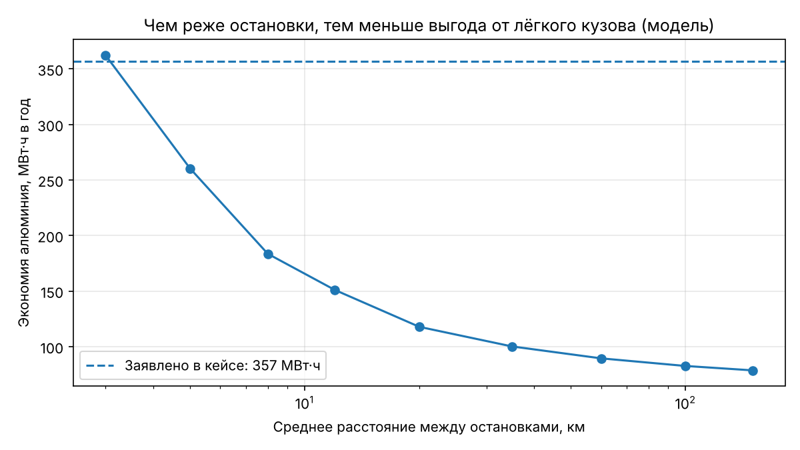

# Модель энергопотребления поезда

`train_energy_sim.py` сравнивает расход энергии поезда 145 т (алюминий) и 180 т (сталь) на одинаковом маршруте.

**Что учитывает:** разгон с ограничением по силе тяги и мощности, движение с постоянной скоростью, торможение, рекуперацию, сопротивление качению (зависит от массы) и воздуха (не зависит от массы).

**Что не учитывает:** уклоны, отопление и кондиционер, дизельную тягу. Это модель, а не замер.

## Результаты

| Сценарий | Алюминий, кВт·ч/км | Сталь, кВт·ч/км | Экономия в год |
|---|---|---|---|
| Кейс: пригородный (90 км, 15 остановок, 140 км/ч) | 6,72 | 7,65 | 227 МВт·ч |
| Казахстан: дальний (1000 км, 8 остановок, 120 км/ч) | 3,42 | 3,72 | 74 МВт·ч |

Влияние рекуперации на пригородном сценарии: 0 % → 440 МВт·ч, 30 % → 334, 60 % → 227. Заявленные в кейсе 357 МВт·ч соответствуют слабой рекуперации или очень частым остановкам (≈ 3 км).

## Запуск

Google Colab: вставить код и запустить. Локально: `python3 train_energy_sim.py` (нужны `numpy`, `matplotlib`).
